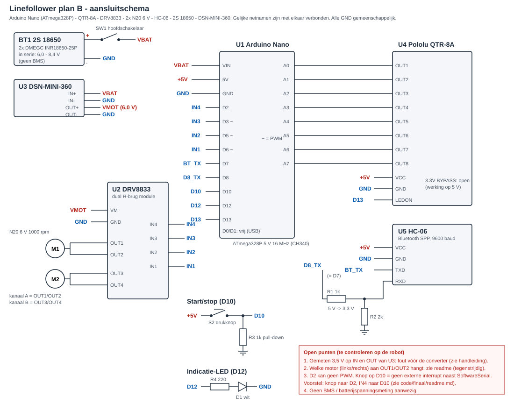

# Elektronisch schema - plan B

[aansluitschema_planB.svg](aansluitschema_planB.svg) (vector) · [aansluitschema_planB.png](aansluitschema_planB.png)

Het schema is getekend op basis van de bedrading van de gebouwde robot (perfboard). Gelijke netnamen zijn met elkaar verbonden.

> **Status EasyEDA-bestand:** [easyeda_linefollower_planB.json](easyeda_linefollower_planB.json) bevat momenteel alleen 5 losse symbolen (DRV8833, QTR-8A, HC-06, 18650-X2S en een *Arduino Pro Micro*), **zonder verbindingen**. Om dat bestand af te werken:
> 1. Vervang het Pro Micro-symbool door een **Arduino Nano**.
> 2. Voeg de DSN-MINI-360, de schakelaar, de drukknop, de LED en R1–R4 toe.
> 3. Leg de verbindingen volgens de netlijst hieronder.
> 4. Exporteer naar PDF (*File > Export > PDF*) en zet die in deze map.

## Netlijst

| net | verbonden pinnen | opmerking |
|---|---|---|
| VBAT | BT1 + via SW1 → U1 VIN, U3 IN+ | 2S: 6,0–8,4 V |
| VMOT | U3 OUT+ → U2 VM | ingesteld op 6,0 V |
| +5V | U1 5V → U4 VCC, U5 VCC, S2 | 5 V-regelaar van de Nano |
| GND | BT1 −, U1 GND, U2 GND, U3 IN−/OUT−, U4 GND, U5 GND, R2, R3, D1 kathode | gemeenschappelijke massa |
| A0…A7 | U1 A0…A7 → U4 OUT1…OUT8 | analoge sensoruitgangen |
| D13 | U1 D13 → U4 LEDON | IR-leds aan/uit (ook de on-board LED) |
| IN1 | U1 D6 (PWM) → U2 IN1 | kanaal A → OUT1/OUT2 |
| IN2 | U1 D5 (PWM) → U2 IN2 | kanaal A |
| IN3 | U1 D3 (PWM) → U2 IN3 | kanaal B → OUT3/OUT4 |
| IN4 | U1 D2 (**geen PWM**) → U2 IN4 | kanaal B |
| M1 | U2 OUT1, OUT2 | motor kanaal A |
| M2 | U2 OUT3, OUT4 | motor kanaal B |
| BT_TX | U5 TXD → U1 D7 | SoftwareSerial RX; 3,3 V-niveau wordt door de Nano als HIGH gelezen |
| D8_TX | U1 D8 → R1 1 kΩ → knooppunt → U5 RXD; knooppunt → R2 2 kΩ → GND | 5 V × 2k/(1k+2k) = 3,33 V |
| D10 | U1 D10 ← S2 ← +5V; D10 → R3 1 kΩ → GND | start/stop, actief hoog |
| D12 | U1 D12 → R4 220 Ω → D1 (wit) → GND | (5 V − ~3 V) / 220 Ω ≈ 9 mA (< 20 mA per pin) |
| D0/D1 | vrij | USB: programmeren + debug |

## Aandachtspunten en openstaande controles

1. **Voeding: 3,5 V gemeten op IN én OUT van de DSN-MINI-360.** Een buck kan niet verhogen, dus de fout zit vóór de converter. Zie de stappen in [gebruiksaanwijzing](../../gebruiksaanwijzing/readme.md#voeding-controleren-en-foutzoeken). De motoren pas laten rijden als VBAT tussen 6,6 en 8,4 V ligt en VMOT 6,0 V is.
2. **Links/rechts tegenstrijdig in de beschrijving:** de linkermotor zou op OUT1/OUT2 zitten, maar werd beschreven als aangestuurd door IN3/IN4 (D3/D2). Op een DRV8833 sturen IN1/IN2 altijd OUT1/OUT2 aan. Het schema volgt de chiplogica. Welke motor links zit, bepaal je met het commando `test a 120`; het resultaat stel je in met `set swap`.
3. **Externe interrupt:** D2/D3 (INT0/INT1) zijn bezet door de motor. D10 heeft alleen een pin-change interrupt, en die vector wordt door SoftwareSerial bezet (bevestigd: linkfout `multiple definition of __vector_3`). **Voorstel (niet uitgevoerd):** wissel twee draden: knop van D10 naar **D2**, en DRV8833 IN4 van D2 naar **D10**. Zo krijgt de knop een echte externe interrupt (INT0) en wordt IN4 een PWM-pin (Timer1). In [config.h](../../code/finaal/linefollower/config.h) pas je dan aan: `PIN_BUTTON 2`, `PIN_B_IN4 10`, `PIN_B_IN4_PWM true`.
4. **LED:** één LED op D12 dient als voedings- én statusindicatie (zie handleiding). Als de opdracht een aparte power-LED vereist die rechtstreeks op de voeding staat, is daarvoor een extra LED + weerstand nodig. Die is **niet** toegevoegd.
5. **Geen BMS en geen batterijspanningsmeting:** alle analoge ingangen zijn door sensoren bezet. Controleer de spanning daarom handmatig.
6. **Arduino VIN:** de Nano vraagt op VIN 7–12 V. Onder ongeveer 7 V (bijna lege batterij) kan de 5 V-rail zakken; daardoor verschuiven de sensorwaarden en kan de HC-06 resetten.
